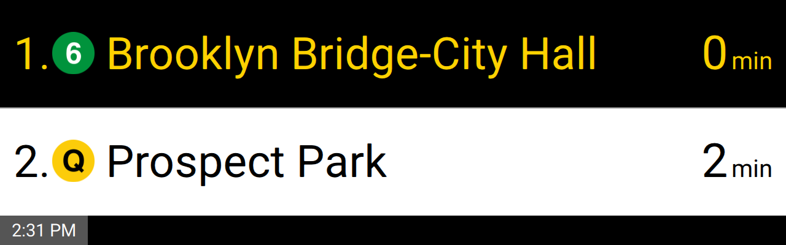
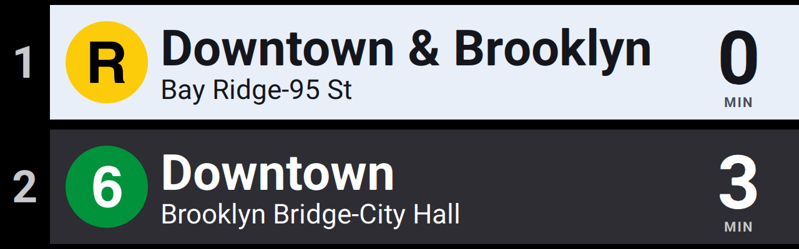
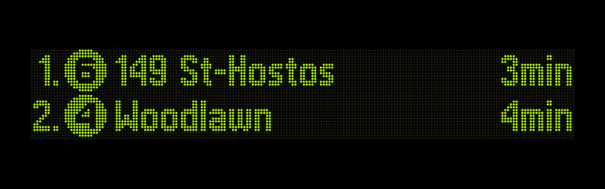
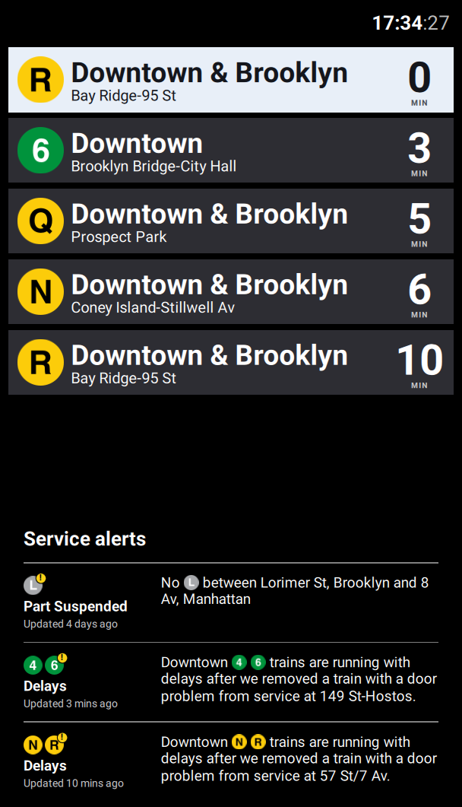

# NYC Subway Countdown Clock

A recreation of the MTA platform countdown clocks, driven by the MTA's live
GTFS-realtime feeds.

It draws three of the MTA's clocks, for any station or group of stations:

| `classic` | `new` |
|---|---|
|  |  |
| **`led`** | **`new`, on a portrait screen** |
|  |  |

It runs on a PC today. The aim is a small screen driven by a Raspberry Pi; see
the [roadmap](docs/roadmap.md) for what is left.

## Quick start

Requires Python 3.10+ and git.

```sh
git clone https://github.com/JohnMcAninley/subway.git
cd subway
python -m venv venv
# Windows: venv\Scripts\activate    macOS/Linux: source venv/bin/activate
pip install -r requirements.txt
python -m subway_clock --dev
```

A window opens straight away. The first run downloads the MTA's schedules
into `data/` and indexes them, which can take a minute; the window shows how
far along that is, and "No connection" if they can't be fetched, trying again
every 15 seconds. After that it shows downtown 6 trains at 28 St. Press S to switch styles, 1-5 to try
screen shapes, and Esc to quit.

To show your own station, make a `settings.json` in the directory you run
from, with your station's stop IDs. `python scripts/find_station.py union sq`
lists them for each line and direction:

```json
{
    "stops": ["635S", "R20S", "L03S"],
    "style": "new"
}
```

That is Union Sq, downtown: the 4/5/6, the N/Q/R/W and the L. See
[Settings](#settings) for the rest. No API key or account is needed.

## Run

```sh
python -m subway_clock [--settings settings.json] [--dev | --fullscreen | --size 1920x600 | --width 1920]
```

The schedules in `data/` are refreshed automatically when the MTA publishes a
new version, in the background while the clock runs. Each start shows "Loading
train times" for the second or two until the first trains are in.

By default the window is frameless at the top left of the screen, the screen's
width at a 3.2:1 ratio. `--fullscreen` is for the device. Press Esc to quit,
or Enter (or M), or click the clock, for the [settings menu](#settings).

`--dev` opens a normal, resizable window for working on the display:

- The QML in `subway_clock/ui/qml/` reloads whenever a file there is saved.
- Keys 1-5 resize the window to preview screen shapes: 3.2:1, 4:1, 16:9, 9:16 (like the
  screens in station entrances), and 1:3.
- S switches between the styles.

## Settings

The settings menu, opened with Enter or M, covers the usual ones: the station,
the style, the station name, alerts, what the last line shows, and whether to
fetch every feed. Up and Down move, Left and Right change the setting selected,
and Esc closes it. Changes show at once and are saved to `settings.json`.
With a mouse, click the clock to open the menu and a setting to change it; the
wheel moves up and down, and the button at the top right, or a click beside the
menu, does what Esc does.

"Station" leads to a search: type part of a station's name or one of its routes
("union", "86 q", "west 4th"), and Enter opens the station found, which lists
each of its platforms' directions with a box to tick. Tick as many as you like,
at as many stations as you like. With nothing typed, the search lists the
stations that have something ticked. Esc goes back a page, and the clock changes
stops on getting back to the first one; if nothing is ticked it keeps the stops
it had.

Everything is in `settings.json` (or the `--settings` path), which can also be
edited by hand. Any setting left out uses its default, and the file is
optional. The file is read again whenever it is saved, so changes show up
without a restart (all but `data_dir`); if it can't be read, the clock says so
in its log and carries on as it was.

```json
{
    "stops": ["633S"],
    "style": "classic",
    "max_trains": 5,
    "max_minutes": 30,
    "rotation": "auto",
    "fetch_all_feeds": true,
    "show_alerts": true,
    "show_station": false,
    "departed_seconds": 300,
    "refresh_seconds": 10,
    "rotation_seconds": 5,
    "data_dir": "data"
}
```

- `stops`: GTFS stop IDs (the settings menu shows each direction's beside its box, and
  `python scripts/find_station.py` followed by part of a station's name lists them). What you
  list decides what kind of clock it is:
  - One direction at one stop, like the clock over a side platform: a directional ID,
    `["633S"]`.
  - Both directions, like the clock on an island platform: a parent ID, `["633"]`.
  - A whole station complex: the IDs of each of its platforms, e.g. Union Sq downtown is
    `["635S", "R20S", "L03S"]`.
  - Several stations at once, which no real clock does: the stops nearest a home or office,
    e.g. `["633S", "R18S"]` for downtown trains from either 28 St station.
- `style`: which MTA clock to look like. `classic` is the LCD clocks with a white screen and a
  time strip; `new` is the newer clocks with a card per train, headed by its direction
  (e.g. "Downtown & Brooklyn") over the destination. In portrait it becomes the screens in station
  entrances: the time, trains under a heading for each direction, and service alerts at the bottom.
  `led` is the LED dot-matrix signs on the numbered lines: green text, an amber line for an
  arriving train, and no alerts. Terminals too long for the sign are abbreviated ("Flatbush Av-Bklyn Col").
- `max_trains`, `max_minutes`: show up to `max_trains` trains, and only those arriving within
  `max_minutes`. The board fits as many lines as the screen's shape allows (2 on a wide bar, 4 at
  16:9, up to 10 in portrait); the last line rotates through the trains that don't fit. A screen
  with more lines than `max_trains` shows more trains.
- `departed_seconds`: an arriving train stays at "0 min" until the feed stops listing it at the
  stop (the nearest thing the data has to "it has left"), or until this long after its arrival
  time if that comes first. The default of 300 just guards against a train stuck in the feed.
  Away from the station, 30 makes room for the next train sooner.
- `refresh_seconds`: how often to fetch the feeds. The MTA republishes them about every 10
  seconds.
- `rotation`: which trains the last line rotates through. `all` is every train up to
  `max_trains`, as the classic and LED clocks do. `unique` stops once every route among them has
  been shown, as the newer clocks do, so the next few trains come round more often. `auto` (the
  default) does whichever the real clocks of the chosen `style` do.
- `fetch_all_feeds`: fetch every realtime feed (about 430 KB per refresh) so rerouted trains always
  appear, including unplanned reroutes. Set to `false` to fetch only the feeds for routes
  scheduled at your stops, including the next week of planned work.
- `show_alerts`: show the MTA's service alerts for your stops and their routes. The classic style
  scrolls them along the bottom strip; the new style shows them in turn with the trains on the
  last line, and gives the screen to one that says why no trains are coming. An alert about a
  whole route's trains in one direction ("Downtown [4] trains are running with delays") is left
  off a clock for the other direction.
- `show_station`: head the screen as the sign over a station entrance does, for a clock that
  isn't in the station: the station's name, the bullets of the routes scheduled to stop at your
  stops, and the direction ("Downtown") when every stop listed is one direction and they share a
  label. Stations with different names are all named ("Jackson Hts-Roosevelt Av / 74 St-Broadway").
  The real clocks have no such thing, so each style does it in its own manner: a black strip
  across the top in `classic`, a line above the cards in `new` (in portrait, the name beside the
  time and the bullets under it), and dots in `led`. The LED sign is narrow: it abbreviates the
  name to fit the bullets beside it, gives them a second line on a screen with room for four, and
  otherwise leaves them out.
- `data_dir`: static GTFS cache. Relative paths are relative to the settings file.

## Development

```sh
pip install -r requirements-dev.txt
pytest
```

PySide6 is pinned to 6.8.2.1 to match the version Debian (and so Raspberry Pi
OS) packages.

`scripts/capture.py` draws a golden case to a PNG, in any style and size
(and with `--station`, the station header), without the live feeds, and with `--loading 42`,
`--no-connection` or `--loading-trains` what a start shows before it has trains; the pictures above were made with it. Qt only prints
QML warnings to the terminal with `QT_FORCE_STDERR_LOGGING=1` set.

## Layout

- `subway_clock/core/`: data and display logic, with no UI code. `Clock` produces a `Board` (the screen description) that renderers draw as-is.
- `subway_clock/ui/`: the Qt Quick front end. `display.py` runs the clock's timers and passes the
  `Board` to `qml/Main.qml`, which only draws it.
- `subway_clock/assets/`: route bullets, the Roboto font, and the direction labels,
  boroughs and complexes (`stations.json`, regenerated by `scripts/update_stations.py`).
- `tests/`: run with `pytest`. `tests/golden/` holds golden cases (captured live feeds and the
  boards they must produce), which double as the spec for other implementations of the core; see
  [tests/golden/README.md](tests/golden/README.md).

## Design

[docs/references.md](docs/references.md) records how the real clocks look and behave, and where
each fact comes from. [tests/golden/README.md](tests/golden/README.md) is the spec for which
trains the board shows and when.

## Data sources

- Realtime: `https://api-endpoint.mta.info/Dataservice/mtagtfsfeeds/nyct%2Fgtfs*` (no API key required)
- Alerts: `https://api-endpoint.mta.info/Dataservice/mtagtfsfeeds/camsys%2Fsubway-alerts`
- Static: `https://rrgtfsfeeds.s3.amazonaws.com/gtfs_subway.zip` and `gtfs_supplemented.zip`
- Direction labels: the MTA's station list, `http://web.mta.info/developers/data/nyct/subway/Stations.csv`

The feeds are used under the MTA's
[terms for its data feeds](https://www.mta.info/developers/terms-and-conditions). This project
isn't affiliated with, licensed by or endorsed by the MTA, and the times it shows may not be
accurate, complete or timely.

## Licence

Copyright John McAninley. Licensed under the GNU General Public License, version 3; see
[LICENSE](LICENSE). The bundled bullets and font keep their own terms, below.

## Credits

- Route bullets are the public domain `NYCS-bull-trans-*.svg` files on
  [Wikimedia Commons](https://commons.wikimedia.org/wiki/Category:New_York_City_Subway_bullets),
  by Flamurai and others. The bullets are MTA trademarks.
- [Roboto](https://github.com/googlefonts/roboto-classic) is licensed under the SIL Open Font License
  (`subway_clock/assets/fonts/OFL.txt`).
- The new style follows Adam Fisher-Cox's
  [write-up of its design](https://www.adamfishercox.com/portfolio/mta-platform-screens/).
- The styles are based on photos of the MTA's platform countdown clocks on Wikimedia
  Commons by Ytx21cn, Tdorante10, and others (CC BY-SA 4.0).
